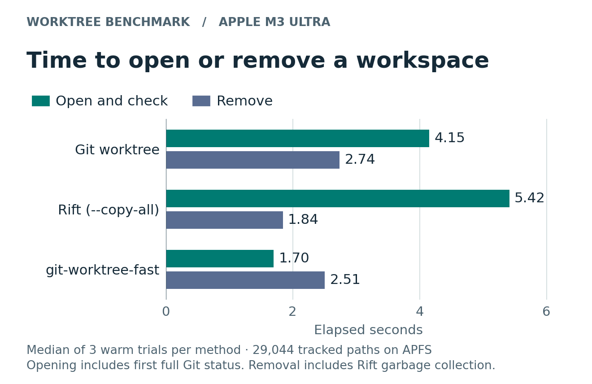
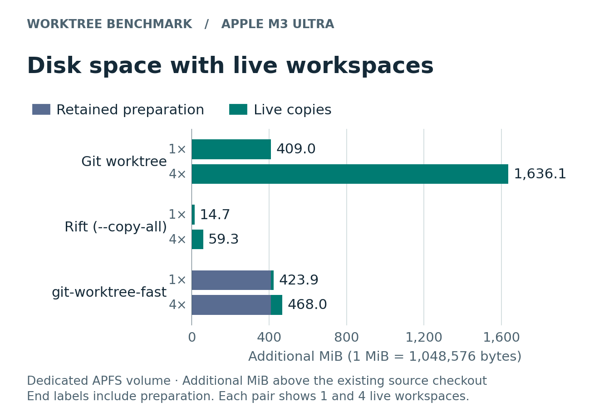

# git-worktree-fast

Keep your current branch open while you fix a bug, review a change, or give an agent a separate checkout. Git calls each of those extra working directories a *worktree*. On a Mac with APFS, `git-worktree-fast` makes repeated worktrees from the same commit quicker to open.

Prepare the commit once. The next time you add a worktree, APFS can share the prepared files’ data blocks until you write to them. You get your own writable files and Git index, and the branch appears in `git worktree list`. Use ordinary Git to commit, move, or remove it. [Browse the guides](docs/README.md).

## Try it in a repository

Install the command with a current stable Rust toolchain, Git, and the Apple Command Line Tools. Git finds the executable when Cargo’s bin directory is on your `PATH`.

```sh
cargo install --locked --git https://github.com/mweinbach/worktree-fast.git git-worktree-fast
git worktree-fast --version
```

If you already cloned this project, `cargo install --locked --path .` installs your local version.

From the repository you want to work in, pick a new branch name and a sibling directory.

```sh
base=$(git rev-parse HEAD)
git worktree-fast prepare "$base"
git worktree-fast add -b fix-login ../fix-login "$base"
git -C ../fix-login status
```

Open `../fix-login` in your editor. Your original checkout stays on its current branch. Once your changes are committed, run these commands from the main checkout to clean up.

```sh
git worktree remove ../fix-login   # The fix-login branch and its commits stay in Git.
git worktree-fast forget "$base"   # Optional. Frees the cache when you’re done with this base.
```

Keep the cache if you expect to start more branches from that commit. Unprepared revisions and unsupported setups, including active checkout hooks, use stock Git. The cached path requires the source cache and new worktree to be on the same APFS volume.

Preparing a commit can also reuse its prepared first parent. Unchanged files share APFS blocks, even across local commits you have never pushed. Run `git worktree-fast auto enable` to prepare new commits in the background and retain the three most recent on each local branch. Change the per-branch limit with `git worktree-fast auto keep N`. [Automatic preparation and cleanup](docs/usage.md#prepare-local-commits-automatically)

## Speed and storage

The charts compare a standard Git worktree, the tracked-source cache in this tool, and an exact Rift snapshot of a clean T3 Code checkout. **Rift gives the snapshot its own Git metadata.** Git and worktree-fast both create linked worktrees that share the repository’s history and refs. Choose the behavior you need as well as the timing.

On an M3 Ultra, Rift returned a directory in **0.36 s**. For an editor or agent that immediately calls `git status`, worktree-fast reached a clean status in **1.70 s**, stock Git in **4.15 s**, and Rift in **5.42 s**. Those are medians of three warm trials per tool, without a package install. Preparing the worktree-fast cache took **4.61 s** once.



For one extra checkout, stock Git used **409 MiB** and worktree-fast used **424 MiB** including its cache. Reusing that cache for four live worktrees brought the total to **468 MiB**, compared with **1,636 MiB** for stock Git. Four Rift snapshots used **59 MiB**, the smallest footprint in this test.



[Exact numbers, storage accounting, and how to reproduce the comparison](docs/performance.md)

## Guides

| If you want to… | Start here |
| --- | --- |
| Use an existing branch, diagnose a cache miss, or clean up | [Using worktrees](docs/usage.md) |
| Understand what is copied, shared, and verified | [How it works](docs/how-it-works.md) |
| Ship the binary with an app or CI job, or hand off a branch | [Bundling and distribution](docs/bundling.md) |
| Measure your own repository | [Performance guide](docs/performance.md) |
| Build from source and run the tests | [Developer quickstart](docs/README.md#work-on-the-tool-locally) |

The source cache works with ordinary Git repositories. You can also group worktrees in a private APFS image or pre-create a pool for agents to claim. The pinned T3 Code demo adds the option to prepare pnpm dependencies ahead of time. [Workflows and examples](docs/usage.md)

[MIT License](LICENSE)
