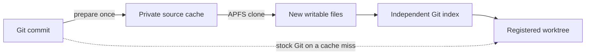

# How it works

Git already shares history between linked worktrees. The expensive part on a
large project can be writing thousands of working files and checking them on
the first `git status`. The source cache gives APFS an already-expanded tree
to clone and gives Git the information it needs to recognize those files.

## From a commit to a working checkout

1. **Prepare a commit.** A repository identifier and the full commit ID select
   the cache entry. On the first preparation, Git writes the tracked files into
   a private directory. If the commit's first parent already has a compatible
   entry, the tool clones that tree, verifies the parent after cloning, and uses
   Git to apply the differences to the clone. It checks the exact file and
   directory names against the target Git tree and builds a fresh index template.
   A changed `.gitattributes`, a damaged parent, or a path spelling the filesystem
   can't reproduce triggers a full checkout. Both paths use only committed files.
2. **Clone and verify.** APFS can give a new file its own identity while
   sharing its data blocks with the prepared file. An edit allocates changed
   blocks for the file being written. The tool checks the source directory's
   identity before cloning. After the clone it verifies the cache inventory,
   file identities, modes, sizes and timestamps against the prepared
   fingerprint. A changed file or an added `.env` invalidates the cache hit.
3. **Give the clone its own index.** A Git index associates tracked paths
   with object IDs and filesystem metadata. The tool starts with Git's
   checksummed index template, keeps the committed object IDs, and fills the
   stat fields from the new files. It accounts for Git's timestamp resolution
   before exposing the checkout. A same-size edit that restores the old mtime
   must still show up on first status.
4. **Hand the worktree to Git.** Git registers a staging worktree, performs
   its normal hard reset against the populated index, and moves the worktree
   to the requested path. This preserves Git's branch selection, `ORIG_HEAD`,
   reflog and normal output. The resulting working files and Git registration
   belong to the new worktree. You can delete the source cache immediately.

The first full status still checks file metadata and looks for untracked
files. On the measured T3 checkout it needed zero tracked-file content scans.
[Timings and measurement boundaries](performance.md)

For the implementation, follow [checkout preparation and publication](../src/checkout.rs),
[cache verification](../src/checkout_proof.rs), and [the Git index writer](../src/stat_index.rs).

## When stock Git takes over

A cached add needs a prepared commit, compatible checkout settings, and a new
destination on the same clone-capable volume as the cache. The CLI delegates
operations it cannot reproduce faithfully, including checkout hooks that need
Git's normal environment, remote branch guessing, sparse trees and
`add -B`. On Linux the ordinary add path invokes the system Git. If you need
to see which path a specific add took, enable `WORKTREE_FAST_TRACE=1`.
[Usage and troubleshooting](usage.md#check-whether-the-cache-was-used)

## What gets shared

| Workflow | Shared resources | Lifetime |
| --- | --- | --- |
| Native Git or a source-cache worktree | Git objects and refs. With the APFS cache, unchanged source data blocks can also be shared. Each worktree owns its working files and index. | Removing the working directory with `git worktree remove` leaves its named branch. `forget` retires the optional prepared source. |
| Shared T3 dependency setup | Registry packages in a prepared pnpm store. The four mutable mobile packages are rebound to the current checkout's sources. | A lease in Git's per-worktree admin directory protects the store through moves. Native removal releases it. |
| Private image group | A clone of an APFS backing file is attached once per group. Each prepared member has its own payload, branch and index. | `image remove` detaches the group and unlinks its backing file. The named branches stay in Git. |
| Prewarmed pool | The pool sets aside a fixed number of already-created branches and checkouts. | A claim returns one slot exactly once. Remove claimed checkouts with Git and drain unused slots before retiring the pool. |

APFS sharing matters when interpreting storage numbers. A directory's apparent
size counts the bytes its files expose. Two writable files can each expose the
same bytes while sharing physical blocks. Disk cost also includes metadata,
Git state, prepared caches and any changed blocks. [Storage measurement method](performance.md)

## How Rift fits

Rift is useful when you want to take a snapshot of a workspace's current
state. For a Git repository, Rift copies the repository with a detached HEAD
and preserves the source's index and working-tree state. `--copy-all` includes
the full source directory. Rift removes a workspace to its own trash and
`rift gc` reclaims it. [Rift documentation](https://github.com/anomalyco/rift)

The source-cache workflow starts at a commit and creates a linked worktree in
the existing repository. That choice lets another checkout see a commit made
on the new branch immediately, and lets ordinary Git move or remove the
working directory. [Git worktree documentation](https://git-scm.com/docs/git-worktree)

[Try a worktree](usage.md) · [Performance and storage](performance.md) · [Bundling the CLI](bundling.md) · [Project home](../README.md)
