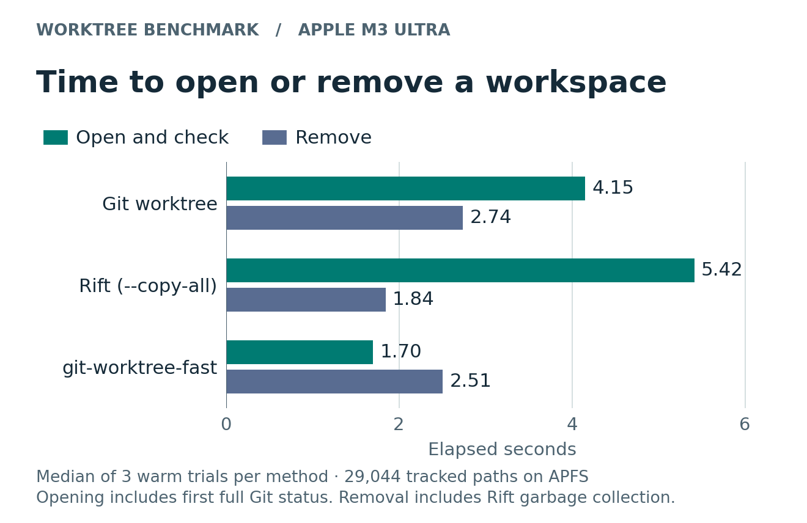
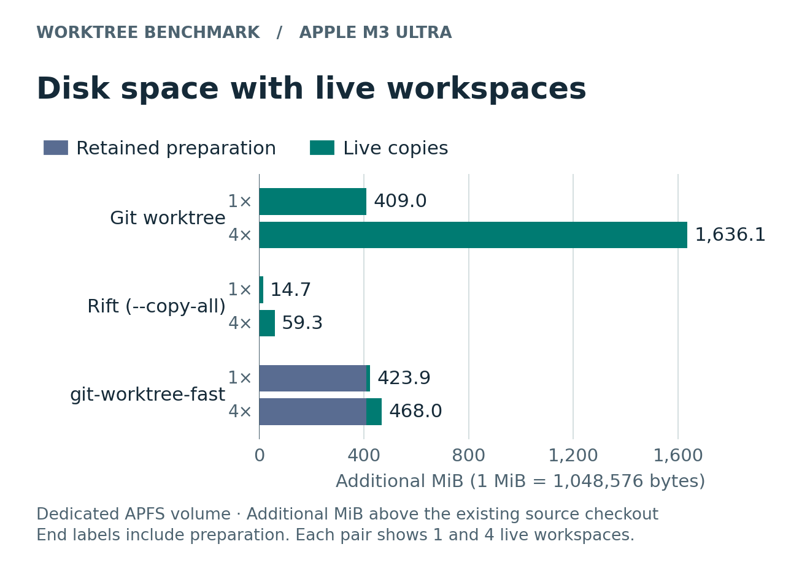

# Performance and disk space

A workspace is useful once you can start working in it. Many editors, terminals, and coding agents run `git status` as soon as they enter a checkout. The main speed comparison measures **creation plus the first full status**. There are separate measurements for returning a path, cleaning it up, and preparing a cache.

## What we compared

All three commands started from the same clean T3 Code commit on an Apple M3 Ultra running macOS 27.2. The commit, [`15fe2832`](https://github.com/pingdotgg/t3code/commit/15fe2832727893cbdd2214383f9f971474849695), has 29,044 tracked paths. The tools were Apple Git 2.54.0, worktree-fast 0.1.1 and Rift 0.0.13. These runs cover source files only. Installing packages, launching a dev server, and preparing a private image are separate workloads.

| Method | What opens | How the run is cleaned up |
| --- | --- | --- |
| Stock Git | A detached linked worktree sharing the source repository’s Git objects | `git worktree remove` |
| Rift | An exact snapshot of the clean source, including its own Git metadata, using `rift create --copy-all` | `rift remove` followed by `rift gc` to reclaim its trash |
| worktree-fast | The same kind of linked worktree, created from a prepared APFS source cache | `git worktree remove`. The source cache can be retained or forgotten separately. |

Rift can also snapshot local edits. Here the clean source and `--copy-all` matter because T3 tracks some test fixtures inside directories named `node_modules`. Comparing different sets of files would measure a different job. [Rift v0.0.13](https://github.com/anomalyco/rift/tree/v0.0.13) · [Git linked worktrees](https://git-scm.com/docs/git-worktree)

## Time to open and remove a workspace



The driver rotated the order over three trials per method on the host APFS volume. Each figure below is a median in seconds. “Open + status” and “Through removal” use the totals from each individual trial, so the displayed phase medians can add up differently.

| Method | Return a path | First full status | Open + status | Physical removal | Through removal |
| --- | ---: | ---: | ---: | ---: | ---: |
| Stock Git | 3.54 | 0.68 | 4.15 | 2.74 | 7.59 |
| Rift `--copy-all` | 0.36 | 5.03 | 5.42 | 1.84 | 7.20 |
| worktree-fast | 1.46 | 0.24 | 1.70 | 2.51 | 4.21 |

Rift returned a directory first. Worktree-fast reached a clean Git status first. The cache took **4.61 s** to prepare once. Rift registration took **0.008 s** and stock Git needed no preparation beyond the shared starting repository. These preparation times are outside the table. After the timed status, a separate check compared tracked files against the commit using a fresh index. It ran outside the timing for all three tools.

## Disk space with one to four live workspaces



APFS can give two files the same contents and separate writable identities while letting them share disk blocks. Adding up file lengths or running `du` on each directory can count shared data more than once. For this comparison, storage is the change in free space on a dedicated APFS filesystem. The common starting repository is already on that filesystem. Any extra prepared cache, registry data, Git indexes, and workspace metadata inside the measured volume count toward the totals.

All values below are **additional MiB** (1,048,576 bytes). The live-workspace columns include preparation. Each method had its own fresh APFS container. We kept the workspaces open together, measured after each addition, and waited for three consecutive allocator readings to agree at each step.

| Method | Preparation alone | 1 live | 2 live | 3 live | 4 live |
| --- | ---: | ---: | ---: | ---: | ---: |
| Stock Git | 0 | 409.04 | 818.15 | 1,227.23 | 1,636.08 |
| Rift `--copy-all` | 0.043 | 14.66 | 29.29 | 44.39 | 59.26 |
| worktree-fast | 409.05 | 423.86 | 438.44 | 453.65 | 468.01 |

The first cached worktree added **14.81 MiB** beyond the prepared cache. Stock Git used less space for one checkout. At two live worktrees, the cached pair used **438.44 MiB**, compared with **818.15 MiB** for stock Git. Rift could clone the source and its Git metadata directly and used the least disk space at every measured count.

After all four worktrees were removed and the cache was forgotten, the worktree-fast container was **2.30 MiB** above its starting point. Stock Git ended **3.05 MiB** above baseline and Rift **1.68 MiB** after cleanup. The driver verified that no test workspaces remained. These deltas include filesystem bookkeeping.

Writing to a clone can allocate more blocks. These figures describe clean workspaces at the tested commit. A package install or a large edit will change the result. [Apple’s explanation of APFS clones](https://developer.apple.com/documentation/foundation/about-apple-file-system)

## Repeat the comparison

On macOS, install `git-worktree-fast` and [Rift v0.0.13](https://github.com/anomalyco/rift/releases/tag/v0.0.13). From the worktree-fast repository, fetch the benchmark commit into a new sibling directory on APFS and run the driver. The driver reads the source repository, creates disposable fixtures beside it, and uses macOS’s `hdiutil` and `diskutil` for the storage phase. Progress goes to stderr and the raw report goes to stdout.

```sh
rev=15fe2832727893cbdd2214383f9f971474849695
git init -q ../t3-benchmark-source
git -C ../t3-benchmark-source fetch --depth=1 --no-tags https://github.com/pingdotgg/t3code.git "$rev"
git -C ../t3-benchmark-source switch --detach FETCH_HEAD
mkdir -p results
python3 benchmarks/compare-rift.py ../t3-benchmark-source --revision "$rev" \
  --rounds 3 --copies 4 > results/local-comparison.json
```

The storage experiment uses an 8 GiB sparse image per method, one at a time. Use fewer copies for a larger repository, or run only the timing phase.

Pass `--rift /path/to/rift` or `--fast /path/to/git-worktree-fast` to select other executable locations. Use `--phase timing` or `--phase storage` to run one experiment independently. The prepared workspaces and images are removed on successful completion. The source repository you supplied stays available.

[Benchmark driver](../benchmarks/compare-rift.py) · [Raw measurements](../benchmarks/t3-git-rift-fast.json)

### Regenerate the PNGs

GitHub displays committed PNG files, so readers can see the graphs without running any code. Only the plotting step needs Matplotlib. Run the renderer without arguments to rebuild the two images under `docs/assets/` from the checked-in JSON. To plot your own report in a separate directory, run the following from the repository root.

```sh
python3 -m venv target/chart-env
target/chart-env/bin/python -m pip install matplotlib==3.10.6
target/chart-env/bin/python benchmarks/plot-comparison.py \
  --input results/local-comparison.json --output-dir results/charts
```

[Chart source](../benchmarks/plot-comparison.py)

### Other workloads

The [earlier Rust benchmarks](../benchmarks/README.md) cover Git with four checkout workers, eight simultaneous worktrees, and T3 worktrees with dependencies already installed. Their source-cache benchmark uses a separate fixture and alternating two-way trials. The figures above use only the matched three-way experiment.

[Getting started](../README.md) · [How the cache works](how-it-works.md) · [Using worktrees](usage.md)
